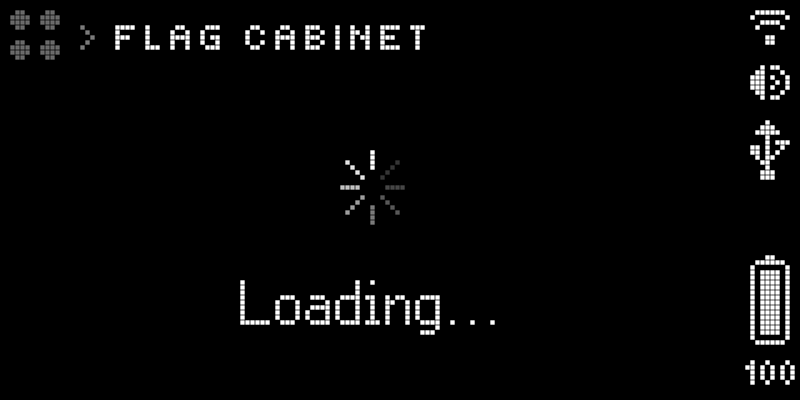

# Flag Cabinet

Put a small national flag on the front of the bar. The rear screen gives its name, its two-letter code where available, and its position in the collection. The flag keeps its original proportions.

## Screen transitions

Browse the flag list in both directions. The incoming flag slides a few LEDs and settles in the center at its original proportions.


<details>

<summary>Watch the rear display</summary>



</details>

## Setup

Open **Apps → Flag Cabinet → Setup**. Set **Startup flag code** to `pl` to open on Poland or leave `ua` for Ukraine. Set **Favorite flag codes** to `ua,pl` and **Seconds per flag** to `5`. Restart the app after saving. Each flag is bundled with the app. No account, companion, or internet connection is required. The picker includes all 254 entries in the country flag image archive. The separate US-state collection is outside this pack.

## Switch between Ukraine and Poland

Open the app on Ukraine. Click the wheel to enter Favorites. Turn one notch to switch between the blue-and-yellow and white-and-red flags. Read the country name on the back.


## Leave a rotation running

Click again to browse the full collection. Hold the wheel on a flag to add it to your saved favorites. In Favorites, press Start to advance automatically at the configured interval. Press Start again to stop. The clip shows a manual pass through the selected flags.


## Run in the emulator

Install BUSY Bar Emulator and open it. From this repository run the following command, then press **Back** when you finish.

```sh
~/.busy-emulator/bin/busy-emulator dev --once
```

The recordings show device controls on emulator firmware. Each LED occupies a 16 × 16 cell with a black border.

The bundled artwork comes from Flagpedia’s country archive. [Flagcdn](https://flagcdn.com/) · [Flagpedia](https://flagpedia.net/).

[Rear display](screenshots/back-1.png) · [MIT license](LICENSE)
